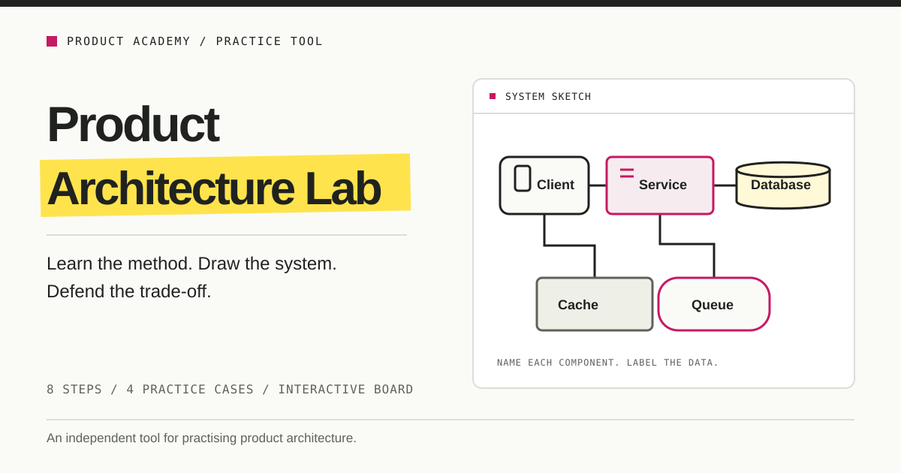

<div align="center">




# Product Architecture Lab

**Learn the method. Draw the system. Defend the trade-off.**

An interactive course and whiteboard for practising product architecture in product management interviews.

</div>

## What it does

Product Architecture Lab takes you from a product prompt to a system you can explain. Work through eight short steps, sketch the components and data flow, compare trade-offs, and practise a concise walkthrough. The four cases include delivery tracking, social notifications, feed ranking, and cross-channel scheduling.

The prompts and worked answers are illustrative practice material. They are not official interview questions or endorsed by an employer.

## Key features

- **Eight-step course** from clarifying the brief through requirements, data flow, component responsibilities, trade-offs, failure handling, and presentation
- **Interactive whiteboard** with draggable clients, services, databases, caches, queues, notes, and free text
- **Drag-to-connect diagrams** with editable data labels on each connection
- **Worked examples** that reveal a diagram and answer for the current step
- **Browser-local progress** for each practice case, with no account or backend

## How to use

1. Choose a practice case and read its prompt.
2. Work through the lessons in order or jump to the step you want to practise.
3. Add components, rename them with a double-click or **Rename selected**, and drag the connector to link them.
4. Click a connection label to name the data that moves between components. Add notes and free text to record assumptions.
5. Write what you would say to an interviewer, then reveal the worked answer or diagram to compare your reasoning.

## Run locally

Clone the repository and open `dist/index.html` in a browser. The app is static HTML, CSS, and JavaScript. It needs no build step, account, API key, or server.

```bash
git clone https://github.com/productdave/product-architecture-lab.git
cd product-architecture-lab
open dist/index.html
```

Your work is saved in that browser's local storage. It is not synced between browsers or devices.

## Tech stack

| Layer | Technology |
|---|---|
| Interface | HTML, CSS, vanilla JavaScript |
| Diagrams | DOM cards, SVG connections, Pointer Events |
| Persistence | Browser `localStorage` |
| Fonts | Plus Jakarta Sans and DM Mono, bundled with their OFL licences |

## Brand assets

The [project logo](assets/lab-logo.svg), [mark](assets/lab-mark.svg), and [cover](assets/readme-cover.svg) use Product Academy's ink and paper palette. The official [Product Academy wordmark](assets/product-academy-wordmark.svg) and [icon](dist/assets/product-academy-mark.svg) are used as supplied. These brand marks belong to Product Academy.

## Status and limitations

This is a working learning prototype. It does not evaluate the quality of an answer automatically, and the example diagrams are deliberately simplified. Progress stays in the current browser. Clearing site data removes it.
